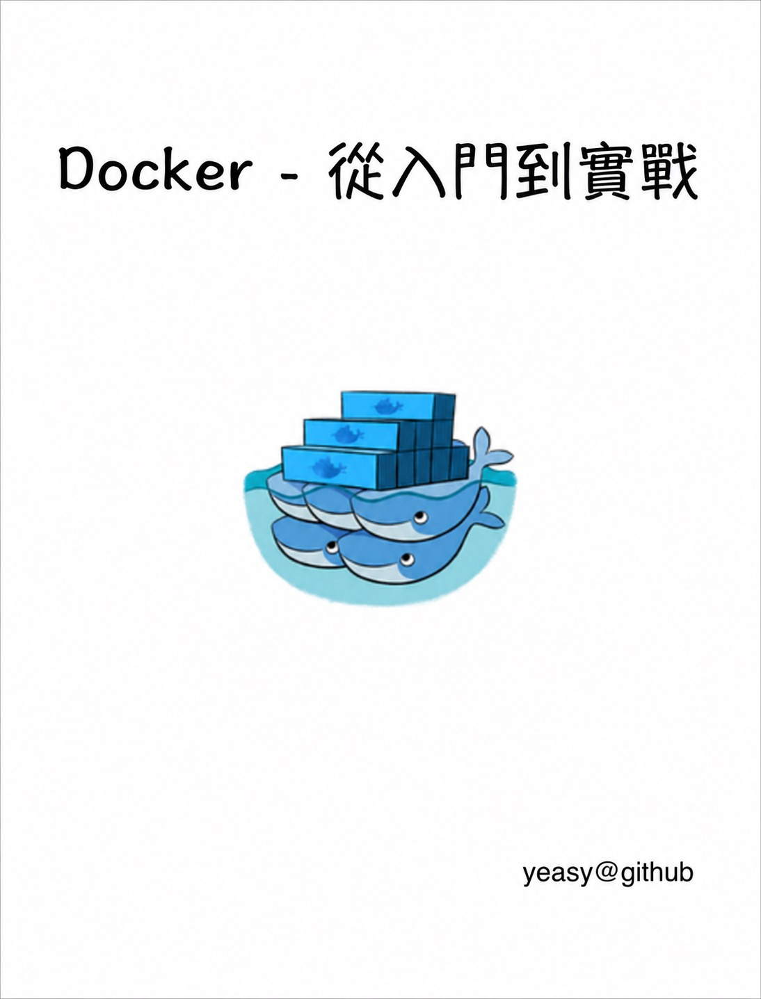

# Docker 從入門到實踐

從執行第一個容器開始，學習映象建立、多服務應用部署與 Kubernetes 編排。

**[在 GitBook 閱讀第一章 · Docker 簡介](https://yeasy.gitbook.io/docker_practice/di-yi-bu-fen-ru-men-pian/01_introduction)**

[全書目錄（GitHub）](https://github.com/doggy8088/docker_practice/blob/master/SUMMARY.md) · [正式 PDF（發布頁）](https://github.com/doggy8088/docker_practice/releases/latest/download/docker_practice-zh-tw.pdf)



## 關於本書

[Docker](https://www.docker.com) 是個劃時代的開源專案，它徹底釋放了計算虛擬化的威力，極大提高了應用的維護效率，降低了雲端運算應用開發的成本！使用 Docker，可以讓應用的部署、測試和分發都變得前所未有的高效和輕鬆！

無論是應用開發者、運維人員、還是其他資訊科技從業人員，都有必要認識和掌握 Docker，節約有限的生命。

本書既適用於具備基礎 Linux 知識的 Docker 初學者，也希望可供理解原理和實現的高階使用者參考。同時，書中給出的實踐案例，可供在進行實際部署時借鑑。

書中內容與範例以 [Docker Engine v29.x](https://docs.docker.com/engine/release-notes/29/) 為基礎。

## 從哪裡開始

- **執行第一個容器** · [安裝並驗證 Docker](https://yeasy.gitbook.io/docker_practice/di-yi-bu-fen-ru-men-pian/03_install) 後，跟隨 [1.1 快速上手](https://yeasy.gitbook.io/docker_practice/di-yi-bu-fen-ru-men-pian/01_introduction/1.1_quickstart) 建立 Nginx 映象，啟動容器並在瀏覽器中開啟頁面。
- **用 Compose 啟動多服務應用** · [安裝 Docker Compose](https://yeasy.gitbook.io/docker_practice/di-er-bu-fen-jin-jie-pian/11_compose/11.2_install)後，跟隨[多服務應用範例](https://yeasy.gitbook.io/docker_practice/di-er-bu-fen-jin-jie-pian/11_compose/11.3_usage)啟動 Flask 應用和 Redis，重新整理頁面驗證訪問計數。
- **用 Kubernetes 部署應用** · [用 kind 建立本地叢集](https://yeasy.gitbook.io/docker_practice/di-san-bu-fen-shen-ru-pian/14_kubernetes_setup/14.4_kind)，再完成 [13.5 實戰練習](https://yeasy.gitbook.io/docker_practice/di-san-bu-fen-shen-ru-pian/13_kubernetes_concepts/13.5_practice)，用 Deployment 部署 Nginx，透過 Service 訪問並觀察捲動更新。

按階段學習、練習與自測，見[附錄八 · Docker 學習路線圖與知識體系](https://yeasy.gitbook.io/docker_practice/fu-lu/appendix/learning_roadmap)。

<details>

<summary>按角色選讀</summary>

| 讀者角色 | 學習重點 | 核心成果 |
|---------|---------|---------|
| **運維新手** | 第 1-6 章 | 掌握容器的基本概念與操作 |
| **開發者** | 第 1-8 章 → 第 11 章 | 學會容器化應用的建立與部署 |
| **DevOps 工程師** | 第 1-11 章 → 第 13-14 章 → 第 18-21 章 | 實現容器編排與自動化部署流程 |
| **架構師** | 第 1-6 章 → 第 12-17 章 → 第 18-19 章 | 設計高可用、高效能的容器基礎設施 |

</details>

## 全書結構

- **入門篇（第 1–6 章）** · 從[第一章](https://yeasy.gitbook.io/docker_practice/di-yi-bu-fen-ru-men-pian/01_introduction)開始，學習映象、容器和倉庫的概念與操作。
- **進階篇（第 7–11 章）** · 從[第七章 Dockerfile 指令詳解](https://yeasy.gitbook.io/docker_practice/di-er-bu-fen-jin-jie-pian/07_dockerfile)開始，學習映象定製、資料與網路管理、Buildx 和 Compose。
- **深入篇（第 12–17 章）** · 從[底層實現](https://yeasy.gitbook.io/docker_practice/di-san-bu-fen-shen-ru-pian/12_implementation)開始，瞭解 Kubernetes、Etcd、容器雲服務和 Podman 等生態專案。
- **實戰篇（第 18–21 章）** · 從[容器安全](https://yeasy.gitbook.io/docker_practice/di-si-bu-fen-shi-zhan-pian/18_security)開始，學習安全防護、監控與日誌，以及作業系統和 CI/CD 案例。

## 延伸閱讀

- [《前線部署工程實踐指南》](https://yeasy.gitbook.io/forward_deployed_engineering_guide/) · 將容器、Kubernetes、GitOps、IaC、供應鏈、安全、觀測與 SLO 組合成可交付、可審計、可運營的部署工程體系。
- 《[Docker 技術入門與實戰][1]》（第 4 版） · [京東圖書][1] · [天貓圖書](https://detail.tmall.com/item.htm?id=997383773726&skuId=6143496614475)

<details>

<summary>更多系列圖書</summary>

- [《智慧體 Harness 工程指南》](https://yeasy.gitbook.io/harness_engineering_guide) · Agent 基礎設施中的容器化部署與隔離。
- [《大模型安全權威指南》](https://yeasy.gitbook.io/ai_security_guide) · 容器安全與 AI 系統安全的交叉實踐。
- [《區塊鏈技術指南》](https://yeasy.gitbook.io/blockchain_guide) · 區塊鏈節點的容器化部署。

</details>

## 反饋與貢獻

歡迎在 [GitHub Issues](https://github.com/doggy8088/docker_practice/issues/new/choose) 報告勘誤或提出建議，也歡迎[參與專案維護](CONTRIBUTING.md)。

[修訂記錄](CHANGELOG.md) · [貢獻者名單](https://github.com/doggy8088/docker_practice/graphs/contributors)

<details>

<summary>本地閱讀與 PDF 預覽版</summary>

安裝 [mdPress](https://github.com/yeasy/mdpress) 後，在倉庫根目錄啟動本地預覽，再開啟 `http://localhost:9000`。

```bash
brew tap yeasy/tap && brew install mdpress
mdpress serve
```

[預設分支 PDF 預覽版](https://github.com/doggy8088/docker_practice/releases/download/preview-pdf/docker_practice.pdf)隨主線更新，正式版本以發布頁為準。

</details>

<details>

<summary>支援專案</summary>

歡迎鼓勵專案一杯 coffee~

<p align="center">

</p>

</details>

<details>

<summary>Star History</summary>

<p align="center">
  <a href="https://star-history.com/#doggy8088/docker_practice&Date">
    
  </a>
</p>

</details>

## 許可證

本書採用 [CC BY-NC-SA 4.0](https://creativecommons.org/licenses/by-nc-sa/4.0/) 許可證。

您可以自由分享和演繹，但需署名、非商業使用、相同方式共享。

[1]: https://item.jd.com/10200902362001.html
